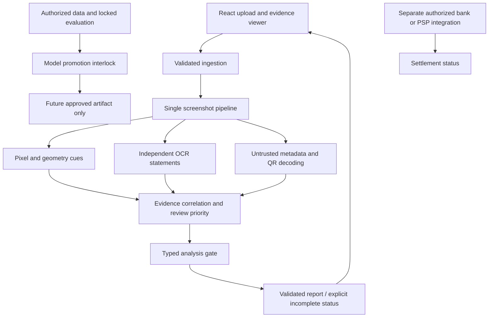

# Unified architecture

One modular FastAPI application and one React client are retained; no unnecessary microservices. Source A means Hackstellar release-gates; source B means ScamShield scaling-enhancements, reversing names in the earlier audit.

The authoritative `ForensicAnalysisReport` contains findings, bounding boxes, raw layer evidence, heuristic score meaning, distinct source coverage and `analysis_gate`. Its Pydantic schema drives validation; the frontend consumes the same decision rather than inventing confidence. Missing gate state blocks by default. No current branch supplies a bank integration; settlement remains false/unverified, and automated approval is unavailable.

A visual no-anomaly result, a readable payment-success string, a valid QR and a signed asset are separate assertions. None implies settlement. Technical failure is represented by processing status and reason codes, not a forged fraud finding. Report-use PASS is not model-release PASS; model promotion needs separately verified data, evaluation, artifact and operational evidence.

The architecture preserves bounded local deployment and existing storage integration while allowing future isolated inference only if measured memory or latency requires it. Exact resource controls, artifact delivery and storage lifecycle changes are covered in SCALABILITY_REPORT and SECURITY_AUDIT. No claim of production cloud readiness is made solely from a local build.
